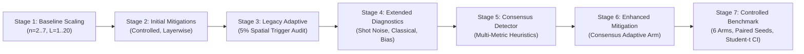

# Demonstrating and Mitigating Barren Plateaus in Random Circuits

[](https://www.python.org/downloads/)
[](https://qiskit.org/)
[-success.svg)](docs/documentation_verification.md)

An end-to-end experimental, diagnostic, and benchmarking investigation into barren plateaus in parameterized quantum circuits (PQCs), evaluating mitigation strategies, measurement noise, inductive biases, and adaptive multi-metric detection.

---

## 1. Abstract

Variational Quantum Algorithms (VQAs) and Quantum Neural Networks (QNNs) face a severe trainability challenge known as the **barren plateau** phenomenon: as register size and circuit depth grow, the variance of parameter gradients vanishes exponentially in the number of qubits ($\text{Var}(\partial_{\theta} C) \in O(2^{-n})$). 

This project implements a comprehensive experimental and auditing framework to:
1. Empirically demonstrate exponential gradient concentration across qubit counts ($n = 2 \dots 7$) and circuit depths ($L = 1 \dots 20$).
2. Analyze initial mitigation strategies, identifying the **"Fixed Combined" paradox** where high gradient variance fails to produce optimization convergence.
3. Diagnose quantum measurement collapse and prove how simulated finite-shot noise can artificially mask a barren plateau.
4. Compare quantum parameter-shift gradient mechanics with classical reverse-mode automatic differentiation.
5. Formulate an enhanced multi-metric plateau detector utilizing gradient magnitude, dispersion, and loss stagnation consensus.
6. Benchmark 6 comparative arms under strictly matched parameter seeds, identical learning rates ($\eta = 0.5$), and exact evaluation budgets ($30nL$ gradient calls), supported by an independent audit and exact two-sided Student's $t$ confidence intervals ($N = 10, \text{df} = 9$).

---

## 2. Problem Statement & Motivation

For random parameterizations forming approximate unitary 2-designs, Haar integration guarantees that gradients concentrate exponentially around zero (McClean et al., 2018). Consequently, determining an optimization descent direction requires an exponential number of circuit measurements ($M \in \Omega(2^n)$), rendering standard gradient descent intractable on classical or NISQ architectures.

Mitigation strategies—such as controlled near-zero initialization (Grant et al., 2019) or layerwise training (Skolik et al., 2021)—attempt to constrain parameter exploration. However, these techniques frequently introduce inductive biases, initial state asymmetries, or optimization subspace trapping. A rigorous, fair benchmark with matched parameter streams and transparent cost accounting is essential to separate genuine optimization gains from statistical artifacts.

---

## 3. Experimental Architecture & Progression

The project progressed through seven verified empirical stages, documented in [`docs/project_architecture.md`](docs/project_architecture.md):



### Stage Summary:
1. **Stage 1: Baseline Barren Plateau Investigation:** Measured gradient variance decay across qubit count $n$ and depth $L$. Non-linear least-squares fit confirmed $\text{Var}(g) \approx 0.5843 \cdot e^{-0.7381 n}$.
2. **Stage 2: Initial Mitigation Experiments:** Tested controlled initialization ($\theta \sim \mathcal{N}(0, 0.1^2)$) and layerwise learning with frozen prior layers.
3. **Stage 3: Original Adaptive Trigger Audit:** Analyzed the 5% spatial variance trigger ($v_{\text{curr}} < 0.05 \cdot v_{\text{ref}}$). Discovered that in unconditioned circuits, gate dispersion collapses below 5% at $L=2$ in 100% of trials, causing step-function activation.
4. **Stage 4: Extended Diagnostics & Bias Analysis:** Demonstrated simulated shot noise RMSE scaling as $O(1/\sqrt{M})$; showed that finite-shot noise creates an artificial variance floor ($1/(2M)$) that can mask barren plateaus; compared parameter-shift with classical backprop; isolated observable locality ($Z_0$ vs $Z^{\otimes n}$) and entanglement effects.
5. **Stage 5: Enhanced Multi-Metric Plateau Detector:** Integrated mean absolute gradient $\mathbb{E}[|g|]$, gradient variance $\text{Var}(g)$, and cost progress into a multi-indicator consensus detector.
6. **Stage 6: Enhanced Adaptive Mitigation:** Integrated the consensus detector into layerwise optimization, eliminating premature step-function triggering.
7. **Stage 7: Controlled CPU Benchmark Sweeps & Statistical Correction:** Benchmarked 6 arms across $n \in \{4, 6\}$ and $L \in \{2, 4, 8, 12\}$ ($N = 10$ trials, 480 trained circuits). Replaced preliminary normal approximations with exact Student-$t$ confidence intervals ($\text{df} = 9$).

---

## 4. Key Scientific Findings & Safeguards

1. **The "Fixed Combined" Paradox (Variance $\ne$ Optimization):**
   At $n=6, L=12$, `Fixed_Combined` preserves the highest gradient variance ($\text{Var}(g) = 0.0675$), yet achieves near-zero optimization progress ($\Delta C = +0.030$, $C(T_{\text{fin}}) = -0.471$). Confining active layers to near-identity while freezing prior layers traps optimization in an affine subspace. **High gradient variance is not sufficient for optimization convergence.**
2. **Decoupling Cost Asymmetry from Algorithm Efficacy:**
   `Controlled_Init` starts at $C(T_0) \approx +0.95$ and achieves $\Delta C = +1.101$ at $n=6, L=12$, but terminates at $C(T_{\text{fin}}) = -0.204$. `Baseline_Uniform` achieves $\Delta C = +0.826$ but reaches a far lower energy $C(T_{\text{fin}}) = -0.785$, and `Adaptive_Enhanced` reaches $C(T_{\text{fin}}) = -0.867$. Both initial and final costs must be reported together.
3. **Inconclusive Conditions under Student-$t$ Intervals:**
   Exact Student-$t$ intervals reveal that marginal $\Delta C$ at $L=12$ crosses zero for all layerwise methods. We honestly report that marginal progress in the final layer is statistically inconclusive at $N=10$; method distinctions rest on cumulative final cost $C(T_{\text{fin}})$.
4. **No Universal Solutions:**
   Controlled initialization and adaptive mitigation do not "solve" barren plateaus asymptotically; all conclusions are restricted to the evaluated small-scale configurations ($n \le 6$).

---

## 5. Technology Stack & Environment

- **Language:** Python 3.12
- **Core Quantum Library:** Qiskit 1.3.2 (`qiskit.quantum_info.Statevector`, `SparsePauliOp`)
- **Scientific Computing:** NumPy 2.2.6, SciPy 1.15.3 (`curve_fit`, `stats.t`)
- **Plotting:** Matplotlib 3.10.9
- **Platform:** Windows 11 (deterministic CPU linear algebra simulation)

---

## 6. Quick Start & Execution

### 6.1 Installation
```powershell
# Create and activate virtual environment
python -m venv .venv
.\.venv\Scripts\Activate.ps1

# Install dependencies
pip install qiskit==1.3.2 numpy scipy matplotlib
```

### 6.2 Verification Smoke Test (< 5 Seconds)
```powershell
python phase7_controlled_benchmark.py --smoke-test
```

### 6.3 Execute Core Modules
```powershell
# 1. Baseline Qubit Scaling
python barren_plateau.py
python fit_exponential.py

# 2. Shot Noise Diagnostics (M = 100, 1000, 10000)
python measurement_shot_noise_experiment.py --qubits 4 --depth 2 --trials 30

# 3. Consensus Plateau Detector
python enhanced_plateau_detector.py --qubits 6 --depths 1 2 4 8 12 16 20 --trials 30

# 4. Controlled 6-Arm Benchmark Sweep (~45 minutes)
python phase7_controlled_benchmark.py --qubits 4 6 --depths 2 4 8 12 --trials 10
```

---

## 7. Project Documentation Directory

| Document | Description |
| :--- | :--- |
| **[`docs/project_architecture.md`](docs/project_architecture.md)** | Subsystem architecture, data flows, and embedded Mermaid diagrams. |
| **[`docs/project_architecture.mmd`](docs/project_architecture.mmd)** | Standalone Mermaid source code for architecture visualization. |
| **[`docs/experimental_methodology.md`](docs/experimental_methodology.md)** | Circuit ansatz, observable definitions, gradient rules, and statistical derivations. |
| **[`docs/results_and_discussion.md`](docs/results_and_discussion.md)** | Comprehensive results discussion, tables, and physical mechanisms. |
| **[`docs/reproducibility_guide.md`](docs/reproducibility_guide.md)** | Step-by-step reproduction instructions and verified CLI commands. |
| **[`docs/limitations_and_future_work.md`](docs/limitations_and_future_work.md)** | Explicit finite-size limitations, runtime bounds, and open research questions. |
| **[`docs/references.md`](docs/references.md)** | Peer-reviewed academic bibliography with DOIs and arXiv links. |
| **[`docs/documentation_verification.md`](docs/documentation_verification.md)** | Documentation verification log, chronology audit, and CLI cross-reference checks. |

---

## 8. Preserved Datasets, Plots & Audit Reports

- **Corrected Benchmark Results:** [`results_phase7_controlled_benchmark_corrected.csv`](results_phase7_controlled_benchmark_corrected.csv)
- **Corrected Benchmark Report:** [`phase7_controlled_benchmark_report_corrected.txt`](phase7_controlled_benchmark_report_corrected.txt)
- **Benchmark Diagnostic Figure:** [`phase7_controlled_benchmark.png`](phase7_controlled_benchmark.png)
- **Independent Audit Report:** [`phase7_independent_audit_report.txt`](phase7_independent_audit_report.txt)
- **Final Verification Checklist:** [`phase7_final_verification.txt`](phase7_final_verification.txt)
