# System Architecture & Pipeline Design

**Project Title:** Demonstrating and Mitigating Barren Plateaus in Random Circuits  
**Document:** System Architecture & Data Flow Reference (`docs/project_architecture.md`)  
**Status:** Verified Complete & Methodologically Audited  

---

## 1. Architectural Overview

The project investigates the phenomenon of barren plateaus (exponential vanishing of parameter gradients in random parameterized quantum circuits), explores mitigation techniques, diagnoses measurement and inductive bias effects, and benchmarks adaptive heuristics.

All numerical simulations are executed in Python 3.12 utilizing **Qiskit 1.3.2** for quantum circuit representations and statevector linear algebra, **NumPy** and **SciPy** for statistical computations, and **Matplotlib** for visualization.

```mermaid
graph TB
    subgraph CoreEngine ["1. Quantum Circuit & Execution Engine"]
        Ansatz["Hardware-Efficient Ansatz<br/>(Single-Qubit Rotations Rx-Ry-Rz + Linear CNOT Entanglement)"]
        StatevectorEngine["Qiskit Statevector Simulator<br/>(Exact Numerical State Evolution)"]
        ParamShift["Parameter-Shift Rule<br/>[C(θ + π/2) - C(θ - π/2)] / 2"]
        Observable["Target Observable<br/>Local Pauli-Z on Qubit 0 (Z_0)"]
        Ansatz --> StatevectorEngine
        ParamShift --> StatevectorEngine
        Observable --> StatevectorEngine
    end

    subgraph Stage1 ["Stage 1: Baseline Characterization (Sept 2026)"]
        ScriptQubits["barren_plateau.py<br/>(Qubit Scaling n=2..10)"]
        ScriptDepth["depth_experiment.py<br/>(Depth Scaling L=1..20)"]
        ScriptExp["fit_exponential.py<br/>(Exponential Model Fit)"]
        
        CSV_Qubits["results_baseline_qubits.csv"]
        CSV_Depth["results_baseline_depth.csv"]
        Plot_Qubits["barren_plateau_qiskit.png"]
        Plot_Depth["barren_plateau_depth.png"]
        Plot_Exp["exponential_fit_qubits.png"]

        ScriptQubits --> CSV_Qubits --> Plot_Qubits
        ScriptDepth --> CSV_Depth --> Plot_Depth
        CSV_Qubits --> ScriptExp --> Plot_Exp
    end

    subgraph Stage2 ["Stage 2: Initial Mitigation Strategies (Sept 2026)"]
        ScriptCtrlInit["mitigation_controlled_init.py<br/>(Controlled Normal Init)"]
        ScriptLayerwise["mitigation_layerwise.py<br/>(Initial Layerwise)"]
        ScriptLayerwiseCorr["mitigation_layerwise_corrected.py<br/>(Sequential Layerwise Training)"]

        CSV_CtrlInit["results_mitigation_controlled_init.csv"]
        CSV_Layerwise["results_mitigation_layerwise.csv"]
        CSV_LayerwiseCorr["results_mitigation_layerwise_corrected.csv"]
        
        Plot_CtrlInit["mitigation_controlled_init.png"]
        Plot_Layerwise["mitigation_layerwise.png"]
        Plot_LayerwiseCorr["mitigation_layerwise_corrected.png"]

        ScriptCtrlInit --> CSV_CtrlInit --> Plot_CtrlInit
        ScriptLayerwise --> CSV_Layerwise --> Plot_Layerwise
        ScriptLayerwiseCorr --> CSV_LayerwiseCorr --> Plot_LayerwiseCorr
    end

    subgraph Stage3 ["Stage 3: Original Adaptive Trigger (Sept - Oct 2026)"]
        ScriptAdaptMit["adaptive_mitigation.py<br/>(Fixed Combined & Heuristic)"]
        ScriptAdaptTrig["adaptive_trigger.py<br/>(5% Spatial Variance Drop Rule)"]
        ScriptAuditLegacy["audit_adaptive_statistics.py<br/>& validate_adaptive_statistics.py"]

        CSV_AdaptMit["results_adaptive_mitigation.csv"]
        CSV_AdaptTrig["results_adaptive_trigger.csv"]
        CSV_ValTrials["validation_adaptive_trials.csv"]
        CSV_ValSumm["validation_adaptive_summary.csv"]

        Plot_AdaptMit["adaptive_mitigation.png"]
        Plot_AdaptTrig["adaptive_trigger.png"]
        Plot_ValDiag["validation_adaptive_diagnostics.png"]
        Report_AuditLegacy["audit_adaptive_statistics_report.txt"]

        ScriptAdaptMit --> CSV_AdaptMit --> Plot_AdaptMit
        ScriptAdaptTrig --> CSV_AdaptTrig --> Plot_AdaptTrig
        ScriptAuditLegacy --> CSV_ValTrials
        ScriptAuditLegacy --> CSV_ValSumm --> Plot_ValDiag
        ScriptAuditLegacy --> Report_AuditLegacy
    end

    subgraph Stage4 ["Stage 4: Extended Diagnostics & Bias Analysis (Oct 2026)"]
        ScriptExpVal["expectation_value_diagnostics.py<br/>(Variance, MAG, MSG Metrics)"]
        ScriptShotNoise["measurement_shot_noise_experiment.py<br/>(Finite-Shot vs Statevector)"]
        ScriptGradComp["quantum_classical_gradient_comparison.py<br/>(Param-Shift vs Classical Backprop)"]
        ScriptBias["bias_analysis_experiment.py<br/>(Init, Observable & Topology Bias)"]

        CSV_ExpVal["results_expectation_diagnostics.csv"]
        CSV_ShotNoise["results_measurement_shot_noise.csv"]
        CSV_GradComp["results_quantum_classical_comparison.csv"]
        CSV_Bias["results_bias_analysis.csv"]

        Plot_ExpVal["expectation_diagnostics.png"]
        Plot_ShotNoise["measurement_shot_noise.png"]
        Plot_GradComp["quantum_classical_comparison.png"]
        Plot_Bias["bias_analysis.png"]
        Report_ShotNoise["measurement_shot_noise_report.txt"]
        Report_Bias["bias_and_gradient_comparison_report.txt"]

        ScriptExpVal --> CSV_ExpVal --> Plot_ExpVal
        ScriptShotNoise --> CSV_ShotNoise --> Plot_ShotNoise
        ScriptShotNoise --> Report_ShotNoise
        ScriptGradComp --> CSV_GradComp --> Plot_GradComp
        ScriptBias --> CSV_Bias --> Plot_Bias
        ScriptBias --> Report_Bias
    end

    subgraph Stage5 ["Stage 5: Enhanced Multi-Metric Detector (Oct 2026)"]
        ScriptEnhancedDet["enhanced_plateau_detector.py<br/>(MAG, Variance, Flatness Consensus)"]
        CSV_EnhancedDet["results_enhanced_detection.csv"]
        Plot_EnhancedDet["enhanced_detection_diagnostics.png"]
        Report_EnhancedDet["enhanced_plateau_detection_report.txt"]

        ScriptEnhancedDet --> CSV_EnhancedDet --> Plot_EnhancedDet
        ScriptEnhancedDet --> Report_EnhancedDet
    end

    subgraph Stage6 ["Stage 6: Enhanced Adaptive Mitigation & Audit (Oct 2026)"]
        ScriptAdaptEnh["adaptive_mitigation_enhanced.py<br/>(Consensus Detector Trigger)"]
        CSV_AdaptEnh["results_adaptive_enhanced.csv"]
        Plot_AdaptEnh["adaptive_mitigation_enhanced.png"]
        Report_AdaptEnh["adaptive_mitigation_enhanced_report.txt"]
        Audit_Phase6["phase6_verification_audit.txt"]

        ScriptAdaptEnh --> CSV_AdaptEnh --> Plot_AdaptEnh
        ScriptAdaptEnh --> Report_AdaptEnh
        ScriptAdaptEnh -.-> Audit_Phase6
    end

    subgraph Stage7 ["Stage 7: Controlled Benchmark & Statistical Correction (Oct 2026)"]
        ScriptPhase7["phase7_controlled_benchmark.py<br/>(Paired Streams, 6 Arms, Dual Metrics)"]
        CSV_Phase7Raw["results_phase7_controlled_benchmark.csv<br/>(Original Dataset)"]
        Plot_Phase7["phase7_controlled_benchmark.png<br/>(6-Panel Diagnostic Figure)"]
        Report_Phase7Raw["phase7_controlled_benchmark_report.txt<br/>(Preliminary Normal CI)"]
        
        Audit_Phase7["phase7_independent_audit_report.txt<br/>(Independent Audit)"]
        ScriptPhase7Corr["Phase 7 Statistical Correction Engine<br/>(Student-t df=9, ddof=1)"]
        
        CSV_Phase7Corr["results_phase7_controlled_benchmark_corrected.csv<br/>(Corrected Dataset)"]
        Report_Phase7Corr["phase7_controlled_benchmark_report_corrected.txt<br/>(Corrected Report)"]
        Verify_Phase7["phase7_final_verification.txt<br/>(Final Checklist)"]

        ScriptPhase7 --> CSV_Phase7Raw --> Plot_Phase7
        ScriptPhase7 --> Report_Phase7Raw
        CSV_Phase7Raw --> Audit_Phase7
        Audit_Phase7 --> ScriptPhase7Corr
        ScriptPhase7Corr --> CSV_Phase7Corr
        ScriptPhase7Corr --> Report_Phase7Corr
        ScriptPhase7Corr --> Verify_Phase7
    end

    CoreEngine --> Stage1
    CoreEngine --> Stage2
    CoreEngine --> Stage3
    CoreEngine --> Stage4
    CoreEngine --> Stage5
    CoreEngine --> Stage6
    CoreEngine --> Stage7
```

---

## 2. Core Components & Subsystem Specifications

### 2.1 Quantum Circuit Construction & Parameter Handling
- **Ansatz Topology:** Hardware-efficient layered ansatz consisting of alternating rotation blocks and entanglement ladders.
- **Single-Qubit Gate Sequences:** Each layer $l$ applies rotations $R_x(\theta_{l, q, 1})$, $R_y(\theta_{l, q, 2})$, and $R_z(\theta_{l, q, 3})$ on every qubit $q \in \{0, \dots, n-1\}$. A layer contains $3n$ parameters; a circuit of depth $L$ contains $3nL$ parameters.
- **Entanglement Topology:** Linear nearest-neighbor CNOT entangling ladder applying $\text{CNOT}(q, q+1)$ for $q \in \{0, \dots, n-2\}$.
- **Direct Numerical Instantiation:** Circuits are instantiated numerically via explicit Qiskit `QuantumCircuit` calls to eliminate high-level symbolic parameter binding overhead during gradient sweeps.

### 2.2 Cost Evaluation & Observable Mapping
- **Local Observable:** Pauli-Z on Qubit 0, represented in Qiskit reverse little-endian convention as:
  $$O = Z_0 = I^{\otimes (n-1)} \otimes Z = \text{SparsePauliOp}("I" \times (n-1) + "Z")$$
- **Exact Statevector Evolution:** Statevectors $|\psi(\boldsymbol{\theta})\rangle$ are calculated analytically:
  $$C(\boldsymbol{\theta}) = \langle \psi(\boldsymbol{\theta}) | Z_0 | \psi(\boldsymbol{\theta}) \rangle = \text{Re}\left( \langle \psi(\boldsymbol{\theta}) | Z_0 | \psi(\boldsymbol{\theta}) \rangle \right) \in [-1.0, +1.0]$$
- **Target Ground Energy:** Global minimization objective drives $C(\boldsymbol{\theta}) \to -1.0$.

### 2.3 Parameter-Shift Gradient Calculation
- **Exact Analytic Formula:** Gradients with respect to parameter $\theta_k$ are evaluated via the exact two-point parameter-shift rule:
  $$\frac{\partial C}{\partial \theta_k} = \frac{C\left(\boldsymbol{\theta} + \frac{\pi}{2}\mathbf{e}_k\right) - C\left(\boldsymbol{\theta} - \frac{\pi}{2}\mathbf{e}_k\right)}{2}$$
- **Evaluation Cost:** Evaluating the full gradient vector $\nabla C(\boldsymbol{\theta}) \in \mathbb{R}^{P}$ requires exactly $2P$ circuit calls.

### 2.4 Mitigation & Trigger Subsystems
1. **Controlled Initialization (`Controlled_Init`):** Initializes all parameters $\theta_k \sim \mathcal{N}(0, 0.1^2)$ near identity rather than $\mathcal{U}[0, 2\pi)$.
2. **Layerwise Training (`Layerwise_Standard`):** Appends layers sequentially $l = 1 \dots L$. For each layer, $3n$ parameters are trained for 5 steps while all parameters in preceding layers $1 \dots l-1$ remain frozen.
3. **Fixed Combined (`Fixed_Combined`):** Sequentially trains layerwise while active layers are initialized $\mathcal{N}(0, 0.1^2)$ and prior layers are frozen.
4. **Original Adaptive Trigger (`Adaptive_Legacy`):** Employs a single spatial variance ratio:
   $$v_{\text{curr}} = \text{Var}\left(\{\nabla C_{\text{active}}\}\right) < 0.05 \cdot v_{\text{ref}}$$
   where $v_{\text{ref}}$ is measured at layer 1. If triggered, active layer switches from uniform to normal initialization.
5. **Enhanced Multi-Metric Adaptive Trigger (`Adaptive_Enhanced`):** Employs a multi-metric consensus heuristic integrating mean absolute gradient, gradient variance, and loss stagnation:
   $$\text{Trigger} = \left(\mathbb{E}[|g|] < 0.06 \land \text{Var}(g) < 0.01\right) \lor \left(|C_{\text{prior}} - C_{\text{curr}}| < 0.002 \land \mathbb{E}[|g|] < 0.10\right)$$

---

## 3. Data Dependencies & Artifact Lineage

1. **Experimental Source Code:** Python scripts defining circuit builders, gradient evaluators, and experimental loops (`barren_plateau.py` through `phase7_controlled_benchmark.py`).
2. **Tabular Results (CSV):** Raw and aggregated data files storing trial-level or summary metrics (`results_*.csv`).
3. **Diagnostic Visualizations (PNG):** Publication-quality figures generated directly from CSV records via Matplotlib.
4. **Experimental Reports (TXT):** Standalone text reports compiled automatically by the benchmark scripts or auditing procedures.
5. **Independent Audits & Checklists:** Verification artifacts (`FINAL_SCIENTIFIC_AUDIT_REPORT.txt`, `phase6_verification_audit.txt`, `phase7_independent_audit_report.txt`, `phase7_final_verification.txt`).

---

## 4. Hardware Simulation Environment

All executions were performed on a Windows 11 host using an isolated Python 3.12 virtual environment (`.venv`). No external cloud services or physical quantum processors were employed; all simulations rely on deterministic CPU statevector linear algebra.
